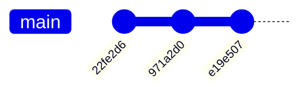
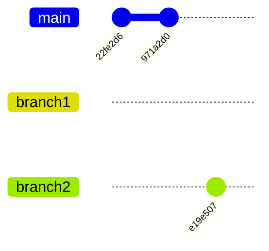
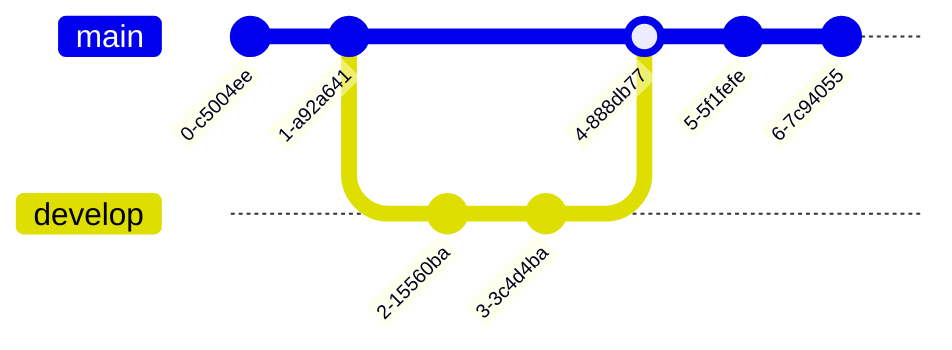

### How Git Works

TODO: remotes, merge conflicts

#### TL;DR

#### Git Object Types

Git objects are stored in the `.git/objects` directory, sorted by their first two SHA characters.
Git stores four types of objects.

| Object | Stores                |
| ------ | --------------------- |
| Blob   | Contents of a file    |
| Tree   | Folder structure      |
| Commit | Tree at this point    |
| Tag    | String commit pointer |

#### Blobs

Blobs store the contents of a file, separate from the name or folder structure.
Each iteration of a file is stored completely, compressed for disk efficiency.
We can thus view all iterations of a file, such as a README.md.

```bash
❯ git rev-list --objects --all | git cat-file --batch-check='%(rest) %(objectname) %(objecttype)' | grep "^README.md"
README.md 0bfce34dbf1a49d3358255cfe93a5a92ce3ec6d8 blob
README.md d37ea637fb2902d81054ee3364b7f54e5fc84aa9 blob
```

We can inspect the contents of each of these blobs.

```
❯ git cat-file -p d37ea637fb2902d81054ee3364b7f54e5fc84aa9
# docs
Documentation and Notes stuff
```

Nothing in the blob identifies this as `README.md`, this is only pure byte content.

#### Trees

Trees represent the folder structure of the directory.
Trees contain blobs or other trees.
We can view the current tree for the blobs and trees it contains.

```bash
❯ git cat-file -p main^{tree}
040000 tree 55b5df069fe3e7c6b7b168a5553d9056412a7642	.github
100644 blob c0b2c6c242fef9539ea8908c6870a9b63b57d419	LICENSE
100644 blob 0bfce34dbf1a49d3358255cfe93a5a92ce3ec6d8	README.md
100644 blob 07d2a096bbd043c9ae39b214490f372576a50603	espresso.md
100755 blob c7acc756769da8415bf47ecbac808728100a7238	grype.md
100644 blob c68e78063531723eacee18be58eb1bf68f5eb1b9	oci.md
```

As well as the trees under the root tree.

```bash
❮ git cat-file -p 55b5df069fe3e7c6b7b168a5553d9056412a7642

040000 tree 61afa69e3486ccc1cc102a8e1621a8121e6e480d	workflows
```

#### Commit

A commit points to a specific tree, indicating an iteration of the file structure.
We can list all commit objects from the object storage.

```bash
❯ git rev-list --objects --all | git cat-file --batch-check='%(objecttype) %(objectname)' | grep "^commit"
commit 587fd4fdef1df8b8d980ce57537df72b1a6a7d55
commit e19e5078bcc8e0987fc20bdb23817351541e97c6
commit 971a2d02c515e460e3a109b00be83bd6646b28a5
commit 22fe2d642f1d17738f1b13eeae9c89b5f8a83b4e
```

Each commit contains a message, an author, the tree it points to, and its parent tree.

```
❯ git cat-file -p 587fd4fdef1df8b8d980ce57537df72b1a6a7d55
tree df95177f1d9c2eafa0376e187b4247cdf0ce83a1
parent e19e5078bcc8e0987fc20bdb23817351541e97c6
author crosleyzack <mail@crosleyzack.com> 1775416624 -0400
committer crosleyzack <mail@crosleyzack.com> 1775416862 -0400
gpgsig -----BEGIN SIGNED MESSAGE-----
...
 -----END SIGNED MESSAGE-----

add espresso guide
```

When we look at `git log`, we are seeing the root trees over time.
When we make a commit, we are adding a new tree to the end of the sequence.



#### Branches

Branches are named pointers to a commit.
Branch definitions live under `.git/refs/heads/`

```bash
❯ ls .git/refs/heads/
main  test
```

A branch contains only the reference to its commit.

```bash
❯ cat .git/refs/heads/test
585bda283b16aa35bf3f26ad6f0d32663c8daf75

❯ git cat-file -p 585bda283b16aa35bf3f26ad6f0d32663c8daf75

tree 65f9ac831dea46d244b6f188d543cb28235c6fad
parent 587fd4fdef1df8b8d980ce57537df72b1a6a7d55
author crosleyzack <mail@crosleyzack.com> 1792461316 -0400
committer crosleyzack <mail@crosleyzack.com> 1792461316 -0400

...
```

Multiple branches can point at the same commit

```bash
❯ cat .git/refs/heads/test
585bda283b16aa35bf3f26ad6f0d32663c8daf75

❯ git checkout -b new
Switched to a new branch 'new'

❯ cat .git/refs/heads/new
585bda283b16aa35bf3f26ad6f0d32663c8daf75
```



The sequence of commits across all branches forms a Directed Acyclic Graph (DAG).

##### Tags

Tags are string identifiers for a commit.
A tag is a file in `.git/refs/tags` which contains only the commit sha it points to.

```bash
❯ cat .git/refs/tags/v1.0.0
62821c676fc3c53b31a470e0461e686359410d15

❯ git show 62821c676fc3c53b31a470e0461e686359410d15 --oneline --no-patch
tag v1.0.0

Release version 1.0.0
-----BEGIN SIGNED MESSAGE-----
...
-----END SIGNED MESSAGE-----
6f9f51d (HEAD -> main, tag: v1.0.0, origin/main, origin/HEAD) how git works init
```

#### Patch

A patch file defines changes to be applied to a set of blobs (files).

```
❯ git format-patch -1 27e5836ee459ad70079e7ac6c0e15998efd13ef1
0001-test.patch

❯ cat 0001-test.patch
From 27e5836ee459ad70079e7ac6c0e15998efd13ef1 Mon Sep 17 00:00:00 2001
From: crosleyzack <mail@crosleyzack.com>
Date: Mon, 19 Oct 2026 21:55:16 -0400
Subject: [PATCH] test

---
 foo.bar | 1 +
 1 file changed, 1 insertion(+)
 create mode 100644 foo.bar

diff --git a/foo.bar b/foo.bar
new file mode 100644
index 0000000..3b18e51
--- /dev/null
+++ b/foo.bar
@@ -0,0 +1 @@
+hello world
--
2.54.0
```

Before pull requests and remotes, code would be shared via patch files

#### Merging

When we do a branch merge, we create a new commit with two parent trees.



You can see this rendered in git.

```bash
❯ git log --all --graph --oneline
*   db6c3b5 (HEAD -> test) Merge branch 'new' into test
|\
| * 54d5f4a (new) stuff
* | 3c3e91c more changes
|/
* faf2869 test
...
```

And we can see the dual parents in the commit object.

```bash
❯ git cat-file -p db6c3b5bb6fbd5ada5099b948b4cbd450c05c5d9
tree f7b6616b0e8ba117b42f90e88678b48e2012f484
parent 3c3e91c73bf999804e0c266dfd3e91d26ebb6ebc
parent 54d5f4a1f5eea255ce9ce7405e3c446084e6e62e
author crosleyzack <mail@crosleyzack.com> 1792462741 -0400
committer crosleyzack <mail@crosleyzack.com> 1792462741 -0400
...
```

#### Rebase

When we do a branch rebase, we put all commits from the branch after the last commit.
This maintains linear history, and is often preferred


````mermaid
gitGraph
   commit id: "22fe2d6"
   commit id: "971a2d0"
   commit id: "6f9f51d4"
   commit id: "587fd4f"
```mermaid
````

#### Pull Requests

A pull request is a request for a repository to pull your tree state and apply it to the repository.
Either this will set the tree state of the repo to the requesting repos, or will combine the states via a merge or rebase
