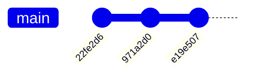
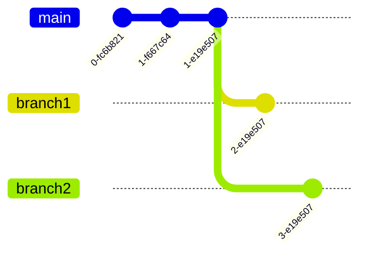
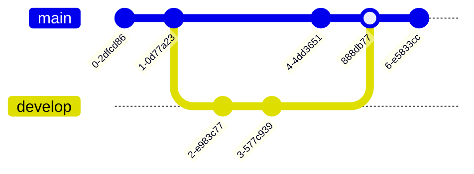
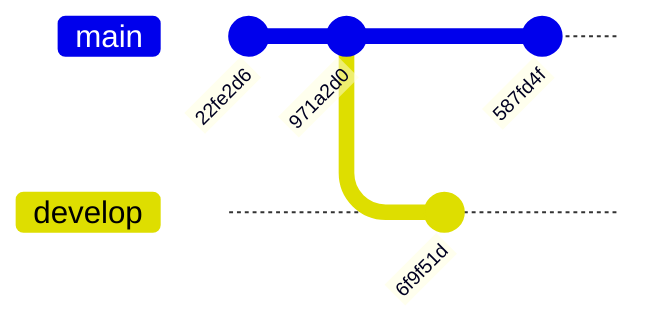
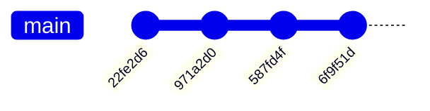
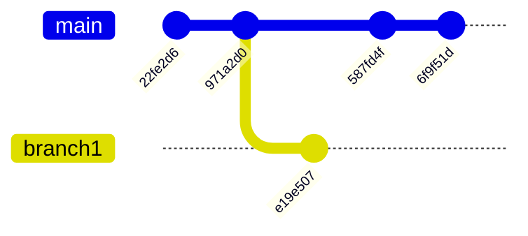

### How Git Works

#### TL;DR

Git is a directed acyclic graph of directory trees which can be selected, combined, and altered to create new trees.

A lot of git can be understood through the file structure of a repositories .git folder:

```
 .git
  ├── HEAD            # current branch, or a commit SHA when detached
  ├── config          # repository settings, remotes, branch tracking
  ├── index           # staging area: the tree for the next commit
  ├── packed-refs     # refs moved out of refs/ by git gc
  ├── hooks           # scripts run on git events
  ├── info            # repo-local exclude rules
  ├── logs            # reflog: history of every ref move
  ├── objects         # blobs, trees, commits, and tags
  │   ├── 0b/...      # loose objects, by first two SHA characters
  │   ├── info
  │   └── pack        # packfiles (.pack) and their indexes (.idx)
  ├── refs
  │   ├── heads       # local branches
  │   ├── remotes     # remote-tracking branches, per remote
  │   └── tags
  └── worktrees       # admin data for linked worktrees
```

#### Objects

Git objects are stored in the `.git/objects` directory, sorted by their first two SHA characters.
Git objects are identified by their SHA-1 hash.
Git stores three types of objects.

| Object | Stores             |
| ------ | ------------------ |
| Blob   | Contents of a file |
| Tree   | Folder structure   |
| Commit | Tree plus metadata |

##### Blobs

Blobs store the contents of a file, separate from the name or folder structure.
Each iteration of a file is stored completely (asterisk this for later), compressed for disk efficiency.
We can thus view all iterations of a file, such as a README.md.

```bash
❯ git rev-list --objects --all | git cat-file --batch-check='%(rest) %(objectname) %(objecttype)' | grep "^README.md"
README.md 0bfce34dbf1a49d3358255cfe93a5a92ce3ec6d8 blob
README.md d37ea637fb2902d81054ee3364b7f54e5fc84aa9 blob
```

We can inspect the contents of each of these blobs.

```
❯ git cat-file -p d37ea637fb2902d81054ee3364b7f54e5fc84aa9
# docs
Documentation and Notes stuff
```

Nothing in the blob identifies this as `README.md`, this is only pure byte content.

##### Trees

Trees represent the folder structure of the directory.
Trees contain blobs (files), other trees (subdirectories), or commits (submodules).
We can view the current tree for the blobs and trees it contains.

```bash
❯ git cat-file -p main^{tree}
040000 tree 55b5df069fe3e7c6b7b168a5553d9056412a7642	.github
100644 blob c0b2c6c242fef9539ea8908c6870a9b63b57d419	LICENSE
100644 blob 0bfce34dbf1a49d3358255cfe93a5a92ce3ec6d8	README.md
100644 blob 07d2a096bbd043c9ae39b214490f372576a50603	espresso.md
100755 blob c7acc756769da8415bf47ecbac808728100a7238	grype.md
100644 blob c68e78063531723eacee18be58eb1bf68f5eb1b9	oci.md
```

As well as the trees under the root tree.

```bash
❮ git cat-file -p 55b5df069fe3e7c6b7b168a5553d9056412a7642

040000 tree 61afa69e3486ccc1cc102a8e1621a8121e6e480d	workflows
```

##### Commit

A commit points to a specific tree, indicating an iteration of the file structure.
We can list all commit objects from the object storage.

```bash
❯ git rev-list --objects --all | git cat-file --batch-check='%(objecttype) %(objectname)' | grep "^commit"
commit 587fd4fdef1df8b8d980ce57537df72b1a6a7d55
commit e19e5078bcc8e0987fc20bdb23817351541e97c6
commit 971a2d02c515e460e3a109b00be83bd6646b28a5
commit 22fe2d642f1d17738f1b13eeae9c89b5f8a83b4e
```

Each commit contains a message, an author, the tree it points to, and its parent commit(s).

Note: the first commit of a new repository will have no parent commit.

```
❯ git cat-file -p 587fd4fdef1df8b8d980ce57537df72b1a6a7d55
tree df95177f1d9c2eafa0376e187b4247cdf0ce83a1
parent e19e5078bcc8e0987fc20bdb23817351541e97c6
author crosleyzack <mail@crosleyzack.com> 1775416624 -0400
committer crosleyzack <mail@crosleyzack.com> 1775416862 -0400
...

add espresso guide
```

When we look at `git log`, we are seeing all commits walking back from the current commit, and thus the successive snapshots of file trees.
When we make a commit, we are adding a new tree to the end of the sequence.



##### Branches

Branches are named pointers to a commit.
Branch definitions live under `.git/refs/heads/`

```bash
❯ ls .git/refs/heads/
main  test
```

A branch contains only the reference to its commit.

```bash
❯ cat .git/refs/heads/test
585bda283b16aa35bf3f26ad6f0d32663c8daf75

❯ git cat-file -p 585bda283b16aa35bf3f26ad6f0d32663c8daf75

tree 65f9ac831dea46d244b6f188d543cb28235c6fad
parent 587fd4fdef1df8b8d980ce57537df72b1a6a7d55
author crosleyzack <mail@crosleyzack.com> 1792461316 -0400
committer crosleyzack <mail@crosleyzack.com> 1792461316 -0400

...
```

Multiple branches can point at the same commit

```bash
❯ cat .git/refs/heads/test
585bda283b16aa35bf3f26ad6f0d32663c8daf75

❯ git checkout -b new
Switched to a new branch 'new'

❯ cat .git/refs/heads/new
585bda283b16aa35bf3f26ad6f0d32663c8daf75
```



The sequence of commits across all branches forms a Directed Acyclic Graph (DAG).
The latest commit for each branch is stored in `.git/refs/heads`

```bash
❯ cat .git/refs/heads/main
033c4d7bb870704a64c326fbc626d87fb7ade899
```

#### References

Git references are pointers to git objects.

| Reference       | Points to                          |
| --------------- | ---------------------------------- |
| Tag             | A git object                       |
| .git/HEAD       | The active git commit              |
| .git/refs/heads | The active git commit for a branch |
| Remote          | Active git commit for each remote  |

##### Tags

Tags are string identifiers for a git object.
A tag is a file in `.git/refs/tags` which contains only the object sha it points to.

```bash
❯ cat .git/refs/tags/v1.0.0
62821c676fc3c53b31a470e0461e686359410d15

❯ git show 62821c676fc3c53b31a470e0461e686359410d15 --oneline --no-patch
tag v1.0.0

Release version 1.0.0
-----BEGIN SIGNED MESSAGE-----
...
-----END SIGNED MESSAGE-----
6f9f51d (HEAD -> main, tag: v1.0.0, origin/main, origin/HEAD) how git works init
```

##### HEAD

Head is a pointer located at `.git/HEAD` indicating which branch is currently checked out.

```bash
❯ cat .git/HEAD
ref: refs/heads/main

docs on  main [!?] on ☁️
❯ cat .git/refs/heads/main
033c4d7bb870704a64c326fbc626d87fb7ade899
```

##### Remote

A remote is a host which git objects can be pushed to or pulled from.
Remote hosts are configured in `.git/config`.
For each remote the current commit at last fetch for that remote is tracked in `.git/refs/remotes`.
A `fetch` operation copies new commit objects as well as their associated trees and blobs from the remote to the local host.
A `push` operation pushes a commit object as well as its associated tree and blobs to the host.
A `pull` operation does first a fetch and then a merge or rebase (usually a merge).
For efficiency, data is transferred as a packfile.

#### Version Control

##### Patch

A patch file defines changes to be applied to a set of blobs (files).
A patch defines removals and additions by line.

```
❯ git format-patch -1 27e5836ee459ad70079e7ac6c0e15998efd13ef1
0001-test.patch

❯ cat 0001-test.patch
From 27e5836ee459ad70079e7ac6c0e15998efd13ef1 Mon Sep 17 00:00:00 2001
From: crosleyzack <mail@crosleyzack.com>
Date: Mon, 19 Oct 2026 21:55:16 -0400
Subject: [PATCH] test

---
 foo.bar | 1 +
 1 file changed, 1 insertion(+)
 create mode 100644 foo.bar

diff --git a/foo.bar b/foo.bar
new file mode 100644
index 0000000..3b18e51
--- /dev/null
+++ b/foo.bar
@@ -0,0 +1 @@
+hello world
--
2.54.0
```

Patches are generated by diff-ing two different commits and storing the changes.
File changes can be described and shared via patch files.

##### Packfiles

git will periodically combine loose `.git/objects` entries into compressed files called packfiles.
Packfiles are stored in `.git/objects/pack`
Packfiles are indexed, compressed datastores for git objects that reduce disk space using [delta compression](https://en.wikipedia.org/wiki/Delta_encoding).
Requests for a specific git object will check the packfile first, before checking loose git objects.
Packfiles can be manually created by running the garbage collector `git gc`.

##### Merging

When we do a branch merge, we create a new commit with two parent commits.



You can see this rendered in git.

```bash
❯ git log --all --graph --oneline
*   db6c3b5 (HEAD -> test) Merge branch 'new' into test
|\
| * 54d5f4a (new) stuff
* | 3c3e91c more changes
|/
* faf2869 test
...
```

And we can see the dual parents in the commit object.

```bash
❯ git cat-file -p db6c3b5bb6fbd5ada5099b948b4cbd450c05c5d9
tree f7b6616b0e8ba117b42f90e88678b48e2012f484
parent 3c3e91c73bf999804e0c266dfd3e91d26ebb6ebc
parent 54d5f4a1f5eea255ce9ce7405e3c446084e6e62e
author crosleyzack <mail@crosleyzack.com> 1792462741 -0400
committer crosleyzack <mail@crosleyzack.com> 1792462741 -0400
...
```

##### Rebase

When we do a branch rebase, we put all commits from the branch after the last commit.
This maintains linear history, and is often preferred.



Rebasing `main` on `develop`



NOTE: in reality, the commit sha `6f9f51d` will change on rebase, as the `parent` field will change and thus the content and hash of the content will change.

##### Pull Requests

A pull request is a request for a remote repository to pull your tree state and apply it to the repository.
Either this will set the tree state of the repo to the requesting repos, or will combine the states via a merge or rebase

##### Conflicts

Conflicts are handled via the [three-way merge algorithm](<https://en.wikipedia.org/wiki/Merge_(version_control)#Merge_algorithms>).
When determining conflicts between two commits, git uses the most recent common ancestor.
Each change is diff'd with the most recent ancestor.
Diffs are then intersected to find overlapping changes.



In the example above:

1. The repository state (commit) in `6f9f51d` and `e19e507` are diff'd against `971a2d0`.
2. The two diff's are intersected to find overlapping changes.
3. The user must resolve the conflicts, while all other changes are unaffected.

#### Worktrees

A worktree enables multiple, simultaneous changes to be made on a single repository.
Worktrees are stored under `.git/worktrees/<name>`.
New worktrees can be created with `git worktree add`.

```bash
❯ git worktree add test
Preparing worktree (new branch 'test')
HEAD is now at 83470f8 added git references

❯ ls .git/worktrees/test
HEAD  ORIG_HEAD  commondir  gitdir  index  logs  refs
```

The file `.git/worktrees/<name>/gitdir` specifies the directory under which the new worktree resides.
Unlike a fresh clone, the `.git` directory here is a just a file that points back to the worktree in the parent repo.

```bash
❯ cat .git/worktrees/test/gitdir
/home/zackary-crosley/dev/docs/test/.git

❯ cat /home/zackary-crosley/dev/docs/test/.git
gitdir: /home/zackary-crosley/dev/docs/.git/worktrees/test
```

This means that worktrees use less hard drive than a second clone, as we do not have to duplicate the `.git` repo, including git objects and references.
Each worktree can work on its own changes on its own branch without affecting other worktrees.
Because the git objects and references are shared, only one worktree can work on a specific branch at a given time.

#### Hooks

Hooks are executable files that are run on a specific git operation.
Hooks reside under `.git/hooks`.

```bash
❯ ls .git/hooks
applypatch-msg.sample  fsmonitor-watchman.sample  pre-applypatch.sample  pre-merge-commit.sample  pre-rebase.sample   prepare-commit-msg         push-to-checkout.sample    update.sample
commit-msg.sample      post-update.sample         pre-commit.sample      pre-push.sample          pre-receive.sample  prepare-commit-msg.sample  sendemail-validate.sample
```

Hooks are named by the event on which they are run.
For instance, `prepare-commit-msg` will be executed before every git commit message is created.
Hooks with suffix `.sample` are examples and are not executed.

#### Reflog

Git tracks each time a reference is updated in append only files under `.git/logs`.
These files show what commit we changed from, to, and when.
For instance, we can see every time the `main` branch was updated to point to a new commit in `.git/logs/refs/heads/main`.

```bash
✦ ❯ cat .git/logs/refs/heads/main
0000000000000000000000000000000000000000 22fe2d642f1d17738f1b13eeae9c89b5f8a83b4e crosleyzack <crosleyzack@gmail.com> 1773319726 -0400	clone: from github.com:crosleyzack/docs.git
22fe2d642f1d17738f1b13eeae9c89b5f8a83b4e 0286ddd86d98ab02bb3a734e30be0b972d3a0477 crosleyzack <crosleyzack@gmail.com> 1773497109 -0400	commit: create grype and oci docs
0286ddd86d98ab02bb3a734e30be0b972d3a0477 3394dab72b00ed1198eabff559a2cc489ed0c858 crosleyzack <crosleyzack@gmail.com> 1773497182 -0400	commit (amend): create grype and oci docs
...
e19e5078bcc8e0987fc20bdb23817351541e97c6 587fd4fdef1df8b8d980ce57537df72b1a6a7d55 Zackary Crosley <zackary.crosley@chainguard.dev> 1789667850 -0400	rebase (finish): refs/heads/main onto 587fd4fdef1df8b8d980ce57537df72b1a6a7d55
587fd4fdef1df8b8d980ce57537df72b1a6a7d55 13655a82519ebff8f0c632b1efbf1887309202ef Zackary Crosley <zackary.crosley@chainguard.dev> 1792942155 -0400	rebase (finish): refs/heads/main onto 13655a82519ebff8f0c632b1efbf1887309202ef
13655a82519ebff8f0c632b1efbf1887309202ef 83470f878f4b841ed277d7521e4cdaad3016e326 Zackary Crosley <zackary.crosley@chainguard.dev> 1792944201 -0400	commit: added git references
```

The command `git reflog` shows the history of these changes for the current branch and corresponds to the reflog file above.

```bash
✦ ❯ git reflog
83470f8 (HEAD -> main, origin/main, origin/HEAD, test) HEAD@{0}: commit: added git references
13655a8 HEAD@{1}: rebase (finish): returning to refs/heads/main
13655a8 HEAD@{2}: rebase (start): checkout refs/remotes/origin/main
587fd4f HEAD@{3}: rebase (finish): returning to refs/heads/main
587fd4f HEAD@{4}: rebase (start): checkout refs/remotes/origin/main
...
```

Branches can be updated to point at a reference with `git reset`

```bash
✦ ❯ git log --oneline
83470f8 (HEAD -> main, origin/main, origin/HEAD, test) added git references
13655a8 more improvements
033c4d7 packfiles
1c9d757 corrections
944e7dc more git
fe7b0fd fix git graphs
512b818 more git data
6f9f51d how git works init
587fd4f add espresso guide
e19e507 add gitleaks for safety
971a2d0 create grype and oci docs
22fe2d6 Initial commit

✦ ❯ git reset --hard 0286ddd
HEAD is now at 0286ddd create grype and oci docs

✦ ❯ git log --oneline
0286ddd (HEAD -> main) create grype and oci docs
22fe2d6 Initial commit
```

#### Hosting Git

As described in cursor's [git at any scale](https://cursor.com/blog/git-at-any-scale), hosting git is _hard_.
This is because each repository may have thousands of users pushing and pulling code at any given time.
For a push, copies of every new or changed file are pushed as new git objects.
For fetches, new git objects for the caller must be determined, combined into a packfile, and returned.
To avoid synchronization errors, locks often are used causing thousands of write commands to be done in a linear fashion.
Furthermore, git repositories are defined by the `.git` directory, which means each git repo must have a file system for storage (for github, local NVMe disks).
Creating multiple repository replicas for efficiency and resiliency thus requires constant synchronization, resulting in the current [spokes](https://github.blog/engineering/infrastructure/stretching-spokes/) model.
[Other work](https://github.blog/engineering/architecture-optimization/the-bridge-to-agent-scale-git-infrastructure/) to improve this includes adding read-only replicas for fetch commands and locking at the reference rather than repository level.

#### Asterisks

1. Only loose objects are actually stored in full. Most are stored as pack files in `.git/objects/pack` for efficiency. Loose objects are regularly cleaned up via garbage collection.

#### TODO

- index
- moving refs
